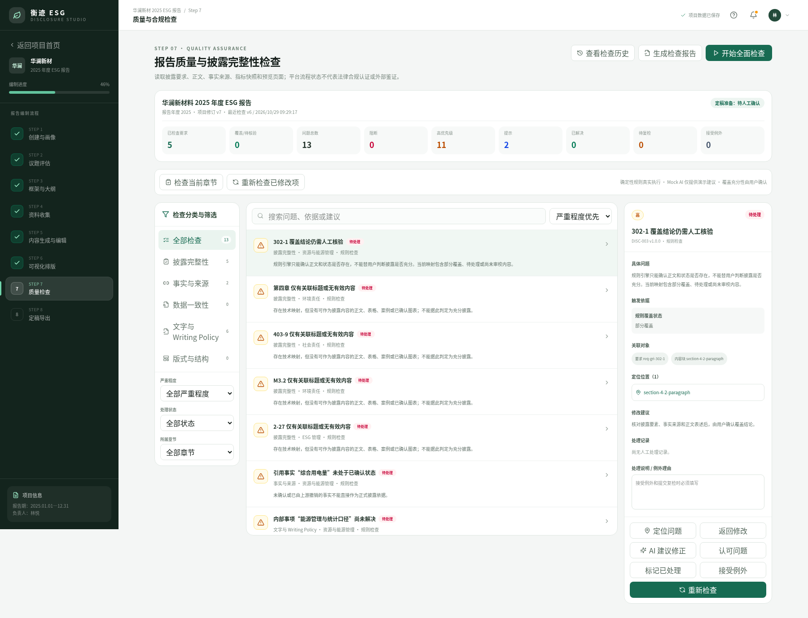

# Step 7.1｜质量检查状态与问题管理修复验收

验收日期：2026-10-29  
开发分支：`feature/step7-1-quality-state-fixes-20261029`  
开发基线：`feature/step7-quality-check-20261028`（`d7cfd4e`）

本轮只修复 Step 7 的检查有效性、稳定问题身份、披露覆盖复核和处理历史；未重新设计页面，未开发 Step 8，也不会自动合并 PR。

## 1. 修复结果

### 全面检查有效性

- `full`、`chapter`、`changed` 三种检查范围分别更新自身范围。
- 只有当前质量输入指纹、当前规则集指纹和成功的全面检查运行同时匹配时，`getStep8QualityGate` 才返回有效。
- 局部检查不再更新 `fullCheck`、不再清除全局 `stale`，也不能把“未全面检查”的报告标记为可提交定稿审核。
- Step 1–6 的相关输入变化会生成 `QualityInvalidationRecord`，保留旧运行并使最近全面检查失效。
- 项目级变化不能精确映射到单个问题时，按整本报告影响处理，避免出现“全局已失效但问题仍显示已确认”的矛盾状态。

### 稳定问题身份和定位

- 同一规则和同一受影响对象在一次运行中只保留一个 `stableKey` 和 `issueId`。
- `SRC-002` 按事实聚合；同一缺陷事实被三个正文块引用时只生成一个问题。
- `QualityIssue.locations` 保留全部章节、正文块、披露要求、事实和图表位置；详情面板可以逐个位置跳转。
- schema v1 中已经存在的重复稳定问题在迁移时合并，旧处理历史和运行历史不删除。

### 披露要求复核

- 覆盖记录保存披露要求修订号和输入指纹。
- 适用性确认、`reviewStatus`、标准/版本、条款内容或章节映射变化后，旧覆盖结论不再沿用。
- `reviewStatus !== 有效` 的适用要求强制进入“待核验”，即使关联正文曾经为“已审校/已覆盖”。

### 问题状态和历史

- 重复全面检查不会为已经解决且未重新出现的问题重复写入“系统复检解决”。
- 已解决问题再次命中时恢复“待处理”，并写入“问题重新打开”，原解决记录仍保留。
- 已接受例外的问题输入变化时清除旧例外状态，写入“例外失效重新确认”。
- 人工“标记已处理”只进入“待复检”；只有确定性规则复检不再命中才能成为“已复检解决”。
- 检查运行、失效记录和人工/系统处理记录不再通过固定条数切片丢弃。

## 2. 状态流转

```text
未全面检查
  ├─ 章节检查 / 修改项复检 ──→ 仍为“未检查”，Step 8 gate=false
  └─ 全面检查成功
       ├─ 阻断问题存在 ──────→ 存在阻断问题
       ├─ 待处理/处理中/待复检 → 待人工确认
       └─ 无活动问题 ────────→ 可提交定稿审核

有效全面检查
  └─ Step 1–6 相关输入变化
       ├─ fullCheck.valid=false
       ├─ stale=true + QualityInvalidationRecord
       ├─ 受影响问题进入待复检
       └─ 局部检查只能更新局部；再次全面检查后才可恢复全局有效
```

Step 8 预留接口：`getStep8QualityGate(project)`。返回 `validFullCheck`、`canSubmit`、准备状态、失效原因、全面检查运行 ID，以及当前输入/规则集指纹。本接口只代表平台内部质量流程，不代表法律合规认证或外部鉴证。

## 3. 数据模型和兼容迁移

`QualityCheckState` 升级为 schema v2，新增：

- `QualityFullCheckRecord`：全面检查输入项目修订、保存后修订、输入指纹、规则集指纹和失效信息。
- `QualityInvalidationRecord`：上游步骤、项目修订、原因、受影响对象和问题 ID。
- `QualityIssueLocation[]`：一个稳定问题对应的多个跨步骤位置。
- `QualityCheckRun.inputFingerprint / ruleSetFingerprint`。
- `DisclosureCoverageRecord.requirementRevision / requirementFingerprint`。
- `Step8QualityGate`：供后续 Step 8 读取的只读有效性判断结果。

schema v1 迁移会保留原问题、运行、处理动作、覆盖结论和 Step 1–6 数据；旧全面检查因缺少可验证指纹而进入待重新全面检查，不会被静默视为有效。

## 4. 自动化测试结果

专用脚本：`scripts/step7-1-state-regression.cjs`  
完整 Step 7 回归：`scripts/step7-browser-regression.cjs`

| 用例 | 实际结果 |
| --- | --- |
| A. 全面检查后上游变化，再做章节检查 | 通过：`fullCheck.valid=false`、`stale=true` 保持，不能定稿 |
| B. 只检查无问题章节 | 通过：没有 `fullCheck`，状态仍为“未检查” |
| C. 同一缺少来源事实被三个块引用 | 通过：一个 `SRC-002` / 一个 `issueId` / 三个定位位置 |
| C+. 只移除其中一个章节的引用后做章节检查 | 通过：问题保留另外两个章节位置，不被误判为整体解决 |
| D. `reviewStatus` 改为待复核 | 通过：原“已核验覆盖”变为“待核验” |
| E. 已复检解决后重复全面检查 | 通过：系统解决记录仍为一条 |
| F. 已解决问题重新出现 | 通过：重新进入待处理，保留解决历史并记录重开 |
| F+. 已接受例外后输入变化 | 通过：例外失效，重新进入待处理并保存失效动作 |
| G. Step 1–7 和 schema v1 存档 | 通过：七个工作台可打开，迁移和刷新恢复正常 |

浏览器结果：0 console error，0 page error。原 Step 7 完整规则回归全部通过；长富文本分页仍为 7 个安全片段，80 个加粗标记、1 个安全链接、45 个列表项全部保留，最大正文溢出 0px。

## 5. 页面截图



## 6. 执行记录

```text
npm run lint       PASS
npm run typecheck  PASS
npm run build      PASS
git diff --check   PASS

node scripts/step7-1-state-regression.cjs  PASS（A–G、例外失效、0 浏览器错误）
node scripts/step7-browser-regression.cjs  PASS（Step 7 完整回归、Step 1–6 路由、富文本分页）
```

## 7. 已知限制

- 原型仍使用浏览器 `localStorage`；没有服务端数据库、多用户并发、权限或正式审计签名。
- 质量输入指纹用于检测项目级业务输入变化；它不是密码学签名，也不替代后端不可篡改审计。
- 覆盖充分性、事实真实性和法规义务仍需人工判断；确定性规则只验证结构、状态和可复现的关系。
- Mock AI 边界不变：仅演示建议流程，不会自动修改正文、确认事实或得出合规结论。
- Step 8 仍为待开发占位；本轮只提供质量 gate 接口，没有定稿锁定、Word/PDF 导出或归档。

## 8. Pull Request

PR 创建后补充链接；目标分支为 `feature/step7-quality-check-20261028`，不会自动合并。
