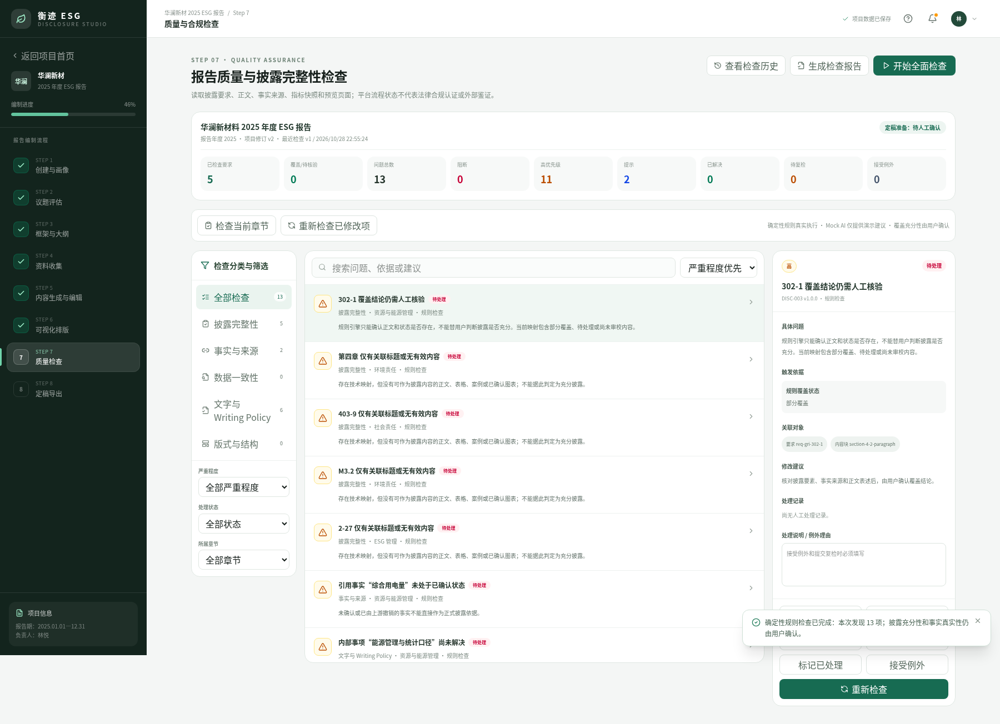
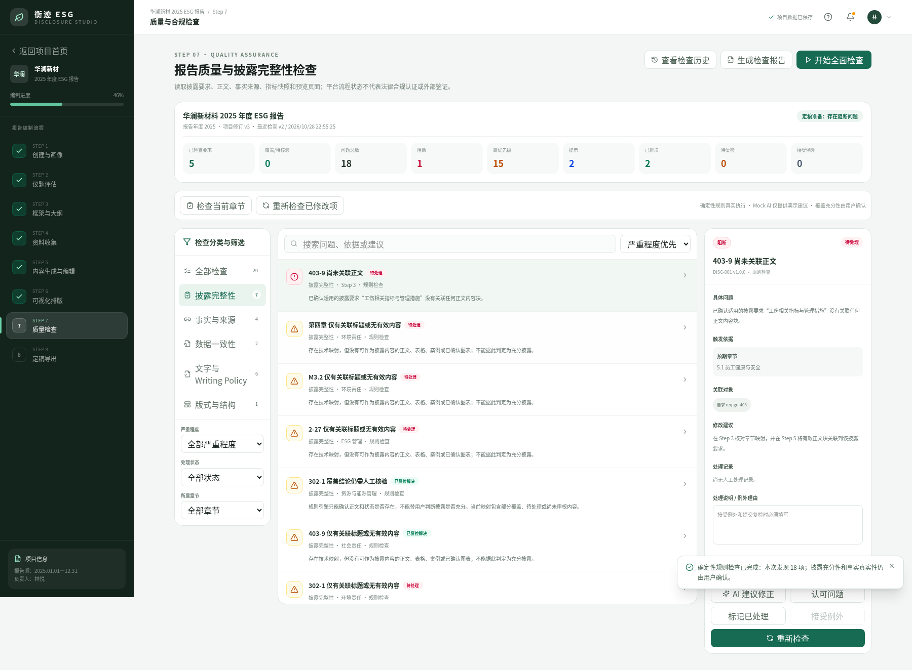
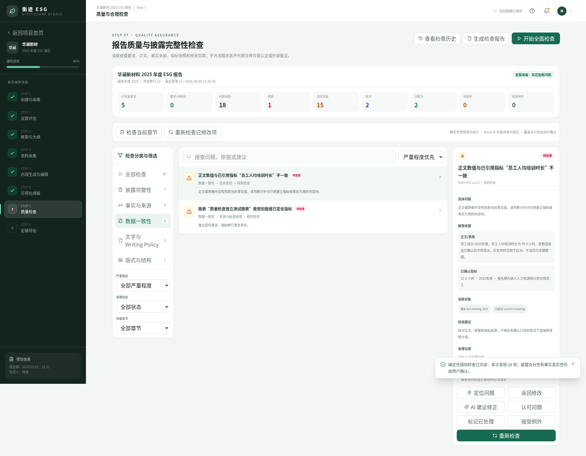
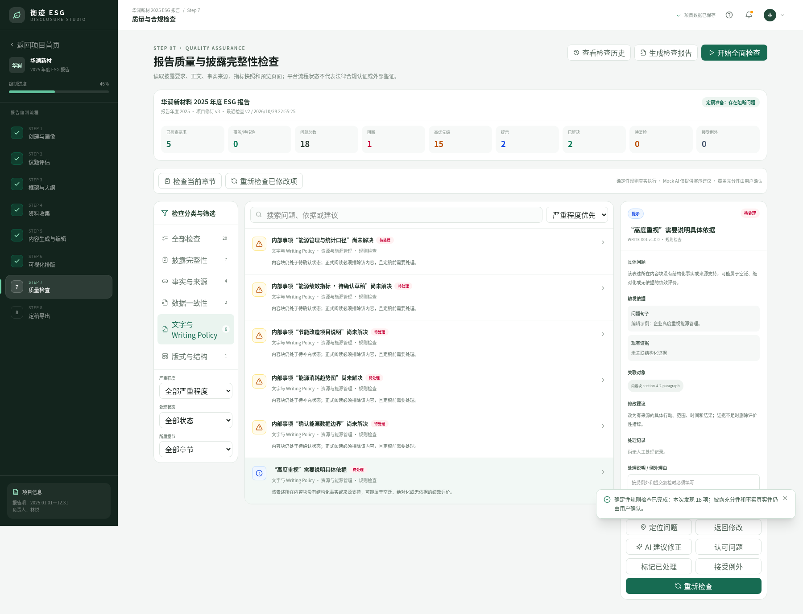
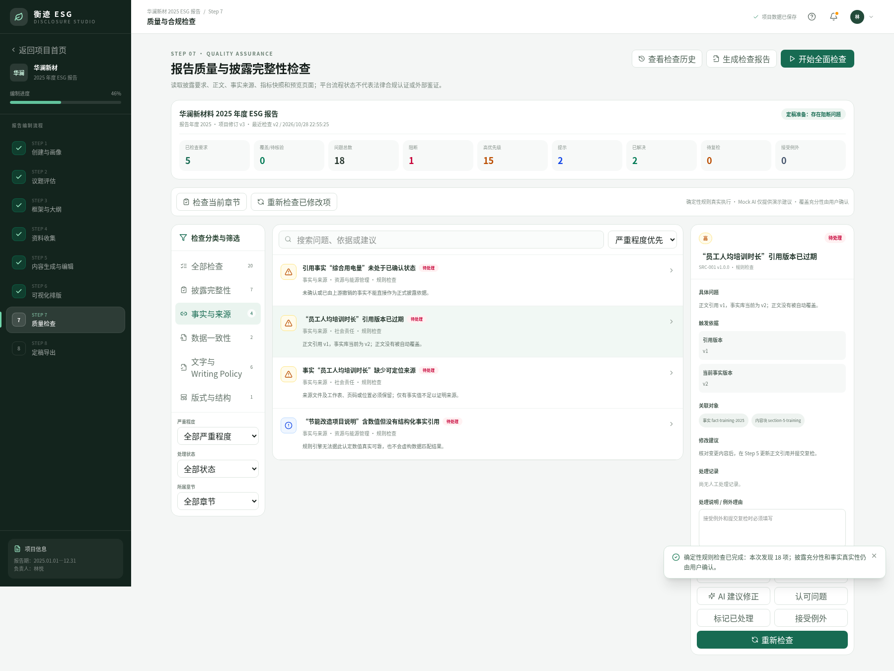
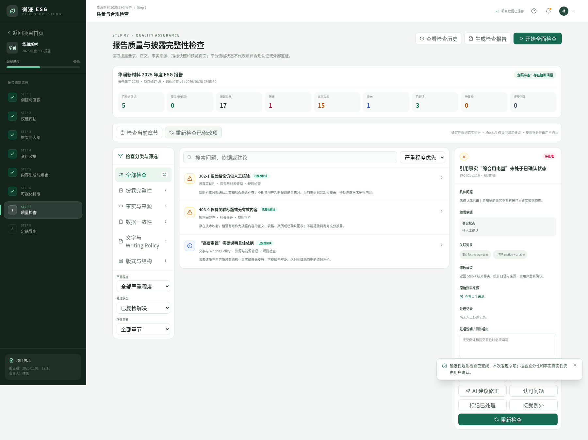

# Step 7 报告质量与披露完整性检查｜验收记录

验收日期：2026-10-28  
开发分支：`feature/step7-quality-check-20261028`  
开发基线：`fix/step6-1-chart-validation-formal-preview-20261028`（`1235676`）  
Step 6.1 遗留修复提交基线：`e000bb4`

本轮没有开发 Step 8，没有自动合并任何 PR。所有浏览器验收均在独立浏览器存储中运行；专用测试记录明确标记为独立模拟数据，不代表示例企业真实绩效。

## 1. 验收截图

### Step 7 质量检查工作台



### 披露完整性问题



### 事实与数据一致性检查



### Writing Policy 检查



### 问题详情与跨步骤定位



### 问题修复及复检



## 2. 数据链路与模块关系

```text
ReportProjectData
├── disclosureRequirements (Step 3)
├── writing.chapters[].blocks[] (Step 5)
│   ├── DisclosureMapping ─────────────┐
│   ├── FactCitation ───────────────┐  │
│   └── SourceReference             │  │
├── facts / presentation.observations (Step 4 / 6)
├── presentation.charts / preview pages (Step 6)
└── quality (Step 7)                │  │
    ├── QualityCheckRun             │  │
    ├── QualityIssue <──────────────┴──┘
    ├── DisclosureCoverageRecord
    ├── QualityActionRecord
    └── QualityCheckSummary / readiness
```

Step 7 不复制整份正文、事实或图表，只保存检查运行、稳定问题身份、现有对象 ID、证据摘要及人工处理记录。项目仍通过 `ReportProjectRepository` 以 `projectId` 隔离；本地存储键不变。

## 3. 新增数据模型

定义位于 `lib/types/quality.ts`：

- `QualityRuleDefinition`：`ruleId`、规则版本、类别、默认严重程度、说明及输入依赖。
- `QualityCheckRun`：运行 ID、项目 ID、范围、输入项目修订、规则版本、命中问题、状态及时间。
- `QualityIssue`：稳定身份、规则、严重程度、来源步骤、章节/内容块/披露要求/事实/图表 ID、来源、证据、建议、状态和处理结论。
- `DisclosureCoverageRecord`：未覆盖、部分覆盖、待核验、已核验覆盖；规则结果不会自动替用户判断充分性。
- `QualityActionRecord`：认可、返回修改、标记已处理、提交复检、接受例外、系统复检解决及 Mock 建议记录。
- `QualityCheckState`：问题、运行、处理记录、覆盖结论、汇总、定稿准备状态、检查项目版本和过期状态。
- `QualityAiTaskProvider`：质量审校任务的统一 `mock/live` Provider 契约。

旧版项目没有 `quality` 字段时，`ensureQualityState` 添加空的 schema v1 状态并记录 `migration-quality-check-v1`；原 Step 1–6 数据、正文、图表快照和版本不变。格式不兼容的旧存档仍会停止保存，不会静默覆盖。

## 4. 确定性检查规则

规则引擎位于 `lib/quality/rules.ts`，与 React 页面解耦。

| 类别 | 规则 | 实际读取与判断 |
| --- | --- | --- |
| 披露完整性 | `DISC-001`～`003` | 适用性确认、章节/正文映射、仅标题、有效内容、部分覆盖、待复核、孤立映射和标准复核状态 |
| 事实与来源 | `SRC-001`～`003` | 事实存在性、人工确认、引用修订、期间、来源文件/位置，以及无结构化引用的数值陈述 |
| 数据一致性 | `DATA-001`～`003` | 同定义/单位/期间/已核验边界的数据冲突、正文/表格引用值、图表快照和确认状态 |
| Writing Policy | `WRITE-001`～`003` | 配置词语及绝对化表述、证据状态、跨章节重复、内部待办与未解决占位 |
| 版式与结构 | `LAYOUT-001`～`003` | Step 3/5 章节及顺序、图表/版面复核、浏览器预览溢出位置 |

关键保护规则：

- 存在正文映射只代表“有内容”，不自动判定充分披露。
- 同名但不同期间或统计边界的数据不会被简单判为冲突。
- 未建立指标级关联的表格明确显示“无法自动核验”。
- 人工“标记已处理”只进入“待复检”；规则再次运行且不再命中后才进入“已复检解决”。
- 接受例外必须填写原因，阻断问题不能通过普通例外绕过。
- Step 1–6 保存后保留旧问题并标记待复检，不覆盖正文或图表快照。

## 5. 真实规则、Mock AI 与人工确认边界

| 类型 | 本轮实现 | 不能代表 |
| --- | --- | --- |
| 确定性规则检查 | 实际读取当前项目数据并可复现地生成、更新和解决问题 | 法规义务判断、事实真实性证明、披露充分性法律结论 |
| Mock AI 检查 | `mockQualityAiProvider` 演示异步任务、警告、建议及处理记录 | 真实语义理解、矛盾识别、无依据陈述认证或自动改写 |
| 人工确认 | 认可问题、处理说明、返回修改、提交复检、接受例外 | 自动规则通过；人工标记不会直接变成“已复检解决” |

Mock AI 建议不会写入正式正文。页面始终显示“Mock AI”，并明确要求用户返回对应步骤确认和修改。

## 6. 实际浏览器测试结果

脚本：`scripts/step7-browser-regression.cjs`  
环境：生产构建、Chromium、1800×1180；控制台错误 0，页面错误 0。

| # | 场景 | 结果 |
| --- | --- | --- |
| 1 | 移除已确认适用要求的正文映射 | 通过：生成 `DISC-001` 未覆盖问题 |
| 2 | 仅保留标题映射 | 通过：生成 `DISC-002`，不判定充分披露 |
| 3 | 修改已引用事实修订号 | 通过：识别正文旧引用版本 |
| 4 | 删除事实来源 | 通过：识别缺少来源文件/位置 |
| 5 | 修改正文指标值 | 通过：对已建立指标引用的正文生成冲突问题 |
| 6 | 添加不同期间及不同边界数据 | 通过：未错误生成同口径冲突 |
| 7 | 图表状态改为“需更新” | 通过：生成 `DATA-003` 图表问题 |
| 8 | `高度重视` 空泛表述 | 通过：显示问题句、证据状态和修改方向 |
| 9 | 未解决内部待办/占位 | 通过：生成 `WRITE-003` |
| 10 | 点击问题定位 | 通过：以 `chapterId`、`blockId` 等稳定 ID 返回 Step 3–6 |
| 11 | 修改后重新检查 | 通过：规则不再命中后进入“已复检解决” |
| 12 | 处理、例外和历史刷新恢复 | 通过：理由、动作、运行历史均由 Repository 恢复 |
| 13 | Step 1 上游保存 | 通过：旧质量结论进入待复检并保留历史 |
| 14 | Step 1–6 路由回归 | 通过：六个既有工作台均可打开，无控制台错误 |
| 15 | 删除旧存档的 `quality` 字段 | 通过：兼容迁移并保留原章节数量 |

运行：

```bash
npm run build
npm run start -- -p 4325
node scripts/step7-browser-regression.cjs
```

## 7. Step 6.1 遗留事项测试

### 堆叠图重复“期间 + 系列”

`validateChartSelection` 现在按组合键统计观测；发现同一期间、同一系列重复时返回具体阻断原因，不能确认图表。测试数据明确标记为独立模拟样本。

```bash
node --experimental-strip-types scripts/step6-1-chart-regression.mjs
```

结果：

- 重复 `2025年度 + 系列 A`：`valid=false`。
- 阻断原因明确指出每个期间与系列只能对应一项观测。
- 独立模拟数据警告保留，不冒充企业指标。

### 长正文富文本格式保真

生产浏览器回归使用最大字号 14、行距 2.2、上下页边距 28mm：

- 长内容拆分为 7 个安全片段。
- 80 个加粗标记全部保留。
- 安全链接 `https://example.com/evidence` 保留。
- 45 个列表项全部保留。
- 文本内容无丢失，最大页面正文溢出 0px。

分页器会在列表项边界换页，并在片段边界关闭/重新打开允许的富文本标签；不通过 `overflow` 隐藏或裁切正文。

## 8. 静态检查

```text
npm run lint       PASS
npm run typecheck  PASS
npm run build      PASS
git diff --check   PASS
```

## 9. 已知限制与后续工作

- 本轮没有真实 AI；充分性、潜在无依据事实及语义矛盾仍需人工判断或后续接入真实 Provider。
- Step 5 表格单元格尚未全部建立指标级引用，未关联表格只提示“无法自动核验”。
- 规则式重复和空泛表述检查是可复现启发式提示，不能取代专业审校。
- Step 3 的不适用理由尚未独立结构化；现阶段检查用户确认和复核状态，后续可增加专用决定说明字段。
- 浏览器 A4 页码仍是预览定位结果；Step 8 需要正式渲染器重新分页并生成最终披露索引。
- 原型使用浏览器 `localStorage`，不包含数据库、多用户权限、实时协作或正式审计签名。
- Step 8 定稿、版本锁定、Word/PDF 导出和年度归档均未开发。

## 10. Pull Request

[PR #6：Step 7 报告质量与披露完整性检查](https://github.com/skdjf24/ESG-Platform/pull/6)

PR 目标分支为完整 Step 6.1 修复分支，不会自动合并。
